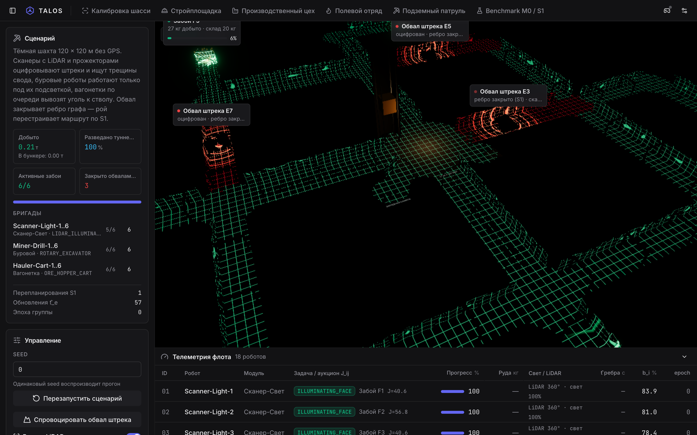
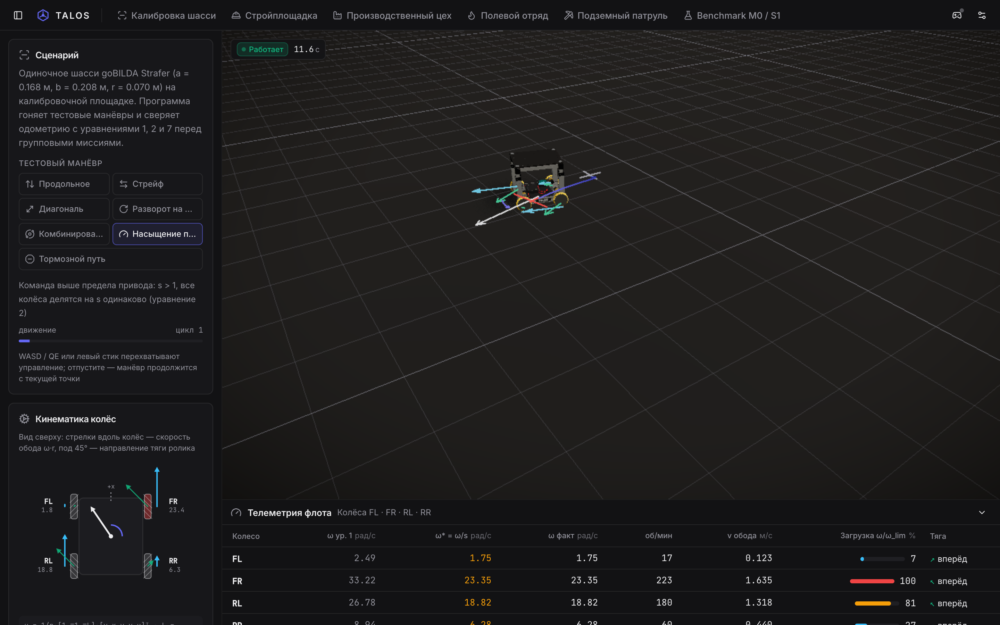
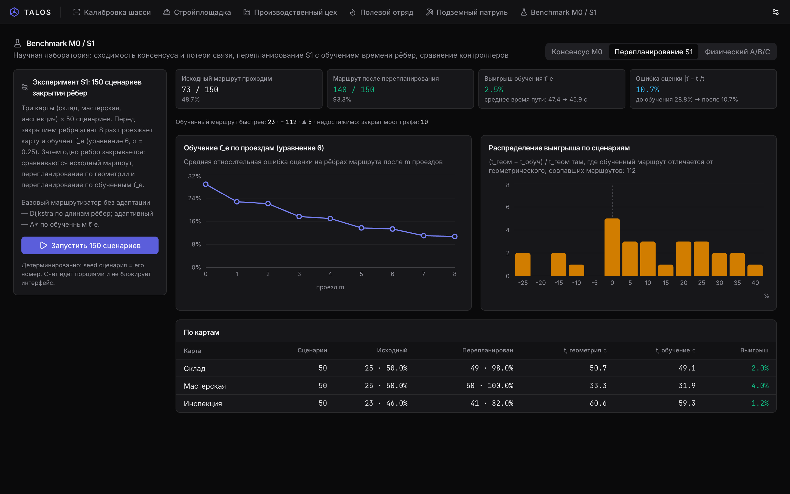
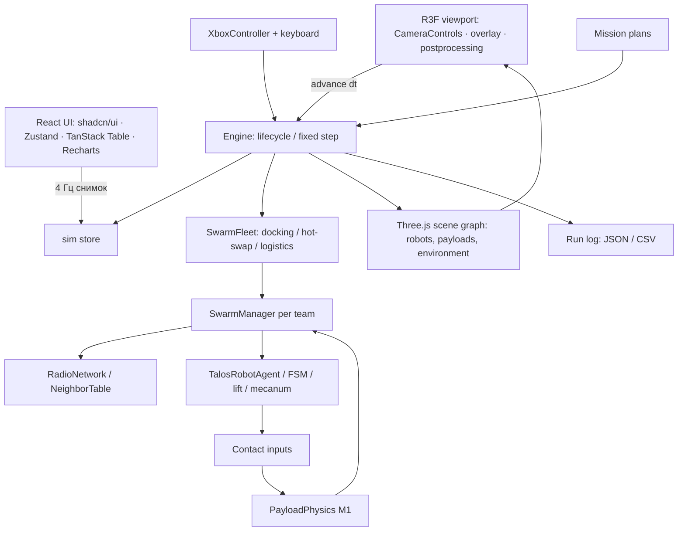

<div align="center">

# TALOS

**Target-Agent Learning & Operational System**

### Совместный подъём. Децентрализованное управление. Измеримый результат.

Модульная платформа мобильных роботов на шасси Mecanum: одна механическая основа под разные задачи, координация агентов через локальный обмен состояниями и перепланирование маршрута при изменении карты. Исследовательский симулятор и научный проект 2026 года.

**Авторы:** Аманбек Батыржан, Әлішер Рашит — 11 класс, лицей-интернат «Білім-инновация» (Қызылорда)

**React 18 · TypeScript · Three.js r170 · React Three Fiber · shadcn/ui · Tailwind CSS · Vite · Vitest**

[Быстрый старт](#быстрый-старт) · [Миссии](#миссии) · [Управление](#управление) · [Математика](#математическая-модель) · [Архитектура](#архитектура) · [Проверки](#проверки)

</div>


*Стройплощадка: 16 роботов в трёх бригадах, включён инженерный оверлей — полигоны опор, векторы реакций и кольца радиосвязи. Реальный кадр приложения.*

## Идея проекта

Мобильный робот в складе, мастерской или на участке проверки решает разные задачи, но часть его механики и логики у них общая: он оценивает своё положение, выбирает путь, сообщает о состоянии задачи и переходит в безопасный режим, когда условия меняются. TALOS строит платформу, в которой эти общие части отделены от задачи:

- **Шасси и сменный модуль.** Mecanum-основа на goBILDA Strafer принимает разное оборудование через монтажные точки. Интерфейс модуля описывает действие, состояние и условие подтверждения выполнения.
- **Профиль среды.** Карта, зоны доступа, типы целей, требуемый модуль и критерий завершения задаются профилем, а не кодом шасси. Для смены задачи меняется профиль, а не весь алгоритм управления.
- **Агент.** Каждый робот хранит собственное состояние, принимает решения по местным данным и соседским сообщениям и публикует свой статус.
- **Координация.** Модель согласования M0 показывает, как локальные обмены сходятся к общему значению при потерях связи. Перепланирование S1 пересчитывает маршрут, когда ребро графа закрыто.

Исследование проверяет две гипотезы в рамках выбранных моделей. Первая: при временных потерях связи в кольцевой топологии состояния агентов достигают заданного порога согласования. Вторая: повторное планирование после известного закрытия ребра увеличивает долю проходимых маршрутов на нескольких профилях среды.

Симулятор показывает эти механизмы в пяти режимах: калибровка одного шасси, строительная площадка с 16 агентами, производственный цех с 20 агентами (резка, сварка, ремонт, логистика, резерв), полевой отряд из 24 роботов против лесного пожара и подземный патруль из 18 роботов в шахте, плюс научный Benchmark M0 / S1. Для каждого режима заданы состав бригад, маршруты и условия отказа, а журнал и экспорт CSV/JSON позволяют повторить эксперимент по seed.

### Результаты, которые можно воспроизвести

| Эксперимент | Что сделано | Результат |
| --- | --- | --- |
| M0, основная серия | 900 запусков: N ∈ {2, 4, 8}, p ∈ {0; 0,1; 0,3}, ε = 0,2, по 100 seed; горизонт 100 шагов | Все 900 запусков достигли D(k) ≤ 0,01. Для N = 8 при росте p с 0 до 0,3 среднее K выросло с 28,14 до 41,17; парная разность 13,03 шага, 95% bootstrap [12,33; 13,73] |
| M0, чувствительность к ε | N = 8, p = 0,3, ε ∈ {0,05; 0,1; 0,2; 0,4}, 100 seed на значение | При ε = 0,05 сошлись 2 из 100 запусков, при ε = 0,1 — 92 из 100, при ε ≥ 0,2 — все 100 |
| S1, перепланирование | 150 случаев закрытия одного ребра на картах склада, мастерской и проверки | Исходный маршрут проходим в 102 случаях (68,0%), пересчитанный — в 143 (95,3%) |
| S1 в симуляторе, `/benchmark` | 150 детерминированных сценариев (3 карты × 50), 8 обучающих проездов до закрытия ребра, сравнение Dijkstra по длинам и A* по обученным `t̂_e` | Исходный маршрут проходим в 73 случаях (48,7%), пересчитанный — в 140 (93,3%); ошибка оценки `t̂_e` на рёбрах задачи падает с 28,8% до 10,7%; обученный маршрут в среднем на 2,5% быстрее (быстрее в 23 сценариях, медленнее в 5, совпал в 112) |

Первые три строки — результаты научной документации; строка «S1 в симуляторе» воспроизводится кнопкой в `/benchmark` на синтетических картах симулятора (закрытие выбирается среди рёбер коридора маршрута), поэтому доли отличаются от документации. Цифры относятся к безразмерным шагам модели и к выбранным графам. Они не переводятся в секунды движения и не являются измерением реального робота.

### Границы

- Физический прототип на базе goBILDA Strafer собран; измерений скорости, тормозного пути, точности траектории и работы сменного модуля на железе пока нет. Для переноса результатов на аппарат предусмотрены отдельные протоколы измерений.
- Радиосвязь в M0 моделируется как случайная потеря рёбер на каждом шаге. Асинхронность, задержки и загрузку реального канала модель не учитывает.
- Локальное обучение (экспоненциальное сглаживание времени прохождения рёбер, α = 0,25) описано как архитектурное предложение. В симуляторе оно включено как переключатель в миссиях и измерено синтетическим экспериментом S1 в `/benchmark` (см. таблицу выше); на реальном графе цеха или шахты эффект отдельно не измерялся.
- Визуальная сцена и физика контактов упрощены: это модель для сравнения стратегий, а не валидированная модель динамики шасси.

## Быстрый старт

Нужны Node.js с npm и браузер с WebGL2. Для разработки удобно использовать Node.js 22; эта версия использовалась при подготовке документации. Геймпад необязателен.

```bash
git clone https://github.com/batryzhan/talos.git
cd talos
npm ci
npm run dev
```

Откройте адрес, напечатанный Vite — обычно **http://localhost:5173**. При занятом порте сервер выберет следующий. Пока загружается CAD-модель `public/robot.glb` (около 30 МБ), вьюпорт показывает индикатор прогресса; затем статус в левом верхнем углу сцены сменится на **Работает**.

| Вкладка | Адрес при стандартном порте |
| --- | --- |
| Калибровка шасси | http://localhost:5173/calibration |
| Стройплощадка | http://localhost:5173/construction |
| Производственный цех | http://localhost:5173/factory |
| Полевой отряд (лесной пожар) | http://localhost:5173/rescue |
| Подземный патруль (шахта) | http://localhost:5173/mining |
| Benchmark M0 / S1 | http://localhost:5173/benchmark |

Ссылки вида `/?mode=N` перенаправляются на режимы: `0` — калибровка, `1` — стройплощадка, `2` — цех, `3` — полевой отряд, `4` — подземный патруль; историческая ссылка `?mode=5` ведёт на `/rescue`. Для первого знакомства откройте стройку, включите **Инженерный оверлей** в карточке «Настройки эксперимента» и выберите камеру **Сверху**. Для воспроизводимого перезапуска введите `seed` и нажмите **Перезапустить сценарий**. Стройплощадка запускает подъём автоматически; цех, полевой отряд и шахта работают автономно, оператор вмешивается кнопками карточки «Управление».

Сборка для размещения на статическом хостинге:

```bash
npm run build
npx vite preview --host 127.0.0.1
```

Готовый сайт находится в `dist/`. Для загрузки модулей и GLB используйте HTTP-сервер; открытие `index.html` через `file://` не является поддерживаемым способом запуска. Маршруты клиентские, поэтому хостинг должен отдавать `index.html` для любых путей (SPA fallback); `vite preview` делает это сам.

## Миссии

### Swarm Agentic Workflow: общая основа трёх миссий

Цех, полевой отряд и шахта построены на одной четырёхслойной архитектуре (разделы 1.4–1.6, 1.10–1.16 документации):

1. **Шасси** — `src/core/agents/SwarmAgent.ts`: goBILDA Strafer (a = 0,168 м, b = 0,208 м, L = 0,376 м, r = 0,070 м). Обратная кинематика Mecanum (уравнение 1), пропорциональное масштабирование при насыщении `s = max(1, max|ω_i|/ω_lim)` (уравнение 2), ограничение скорости тормозным путём `d_stop ≈ vτ + v²/(2a_br)` (уравнение 7). Колёса в 3D вращаются с рассчитанными скоростями — направление вращения роликов соответствует уравнению 1.
2. **Целевой модуль** — `src/core/agents/taskModule.ts`: `moduleId`, `capability`, `state`, `completionConfirmation`; команды идемпотентны по `actionId` и `epoch`. 12 процедурных 3D-модулей (`src/platform/fleet/modules.ts`) рисуются инстансами — по одному draw call на деталь для всего флота.
3. **Агенты и распределение задач** — `src/core/allocation/auction.ts`: консенсус-аукцион с оценкой `J_ij = t̂_ij + w_q·q_i + w_e·r_i + w_u·u_ij` (уравнение 5).
4. **Координация и обучение** — консенсус M0 в рабочих группах (`src/core/consensus/m0Group.ts`, уравнения 3–4), мьютексы с TTL и `epoch` (`src/core/coordination/ResourceMutex.ts`), перепланирование S1 и локальное обучение `t̂_e ← (1 − α)·t̂_e + α·t_e`, `α = 0.25` (`src/core/routing/RouteNetwork.ts`, уравнение 6), hot-swap со сменой `epoch` и фиксацией `t_restore − t_event`.

Физика — 100 Гц, управление — 50 Гц, радио — 20 Гц, UI — 4 Гц. Миссии детерминированы по seed и одинаково работают в браузере и в тестах. Таблица телеметрии показывает модуль, задачу с ценой аукциона `J_ij`, прогресс операции, оценку `t̂` текущего ребра, заряд и `epoch`; над станками и инцидентами висят 3D-бейджи с прогрессом.

### Производственный цех

**Адрес: `/factory`** (`?mode=2`). 20 роботов, цепочка *Раскрой металла → Сборка и сварка → Диагностика и ремонт → Вывоз на склад*:

| Бригада | Модуль | Действие |
| --- | --- | --- |
| Cutter-1…4 | `PLASMA_CUTTER` — жёлто-графитовая башня, поворотный манипулятор, плазмотрон и диск | `CUTTING_METAL`: раскрой листа на станке, направленный поток искр и точечный свет |
| Welder-1…6 | `ARC_WELDER` — шарнирная рука с горелкой и катушкой проволоки | `WELDING_JOINT`: тройки у стапелей A/B согласуют фазу шва консенсусом M0 до `D(k) ≤ 0.01`, затем синхронно ведут шов; бело-голубая дуга и остывающий красный шов |
| Mechanic-1…4 | `REPAIR_DIAGNOSTIC` — стойка с двумя захватами, гайковёртом и оптическим сенсором | `REPAIRING_UNIT`: отказ станка разыгрывается аукционом `J_ij`; победитель едет, диагностирует (синий луч) и чинит |
| Logistics-1…4 | `ROLLER_CARRIER` — роликовый ложемент со сцепкой | `HAULING_PART`: заготовки к стапелям, узлы на склад; мьютексы узких перекрёстков и очередь на станциях |
| Reserve-1…2 | `MULTI_SWAP` на зарядных доках | hot-swap: на 12-й секунде заряд Welder-2 падает до 24,9 %, `epoch++`, безопасный выход, резерв перенастраивает модуль и занимает пост |

Кнопки: **Внедрить поломку станка** (аукцион механиков, таблица ставок `t̂, q, r, u, J` в карточке сценария), **Перекрыть коридор цеха** (закрытие самого загруженного ребра, перепланирование S1 и обновление `t̂_e`), **Симулировать разряд**. Код: [FactoryMission.ts](src/missions/FactoryMission.ts), сцена: [FactoryEnvironment.ts](src/platform/FactoryEnvironment.ts).


### Полевой отряд — лесной пожар

**Адрес: `/rescue`** (`?mode=3`, также `?mode=5`). Процедурный горно-лесной рельеф 140 × 140 м с рекой и бродом; база на берегу. Клеточный автомат пожара (ячейки 2 × 2 м): интенсивность `I_fire ∈ [0, 1]`, расход топлива, распространение с учётом ветра, уклона и влажности; минерализованная полоса не горит; вода гасит пламя до состояния «Потушено».

| Отряд | Модуль | Действие |
| --- | --- | --- |
| Firefighter-1…12 | `WATER_CANNON`, бак 40 л | `SUPPRESSING_FIRE`: полукольцо с наветренной стороны; опорный азимут секторов согласуется M0, слоты — аукционом `J_ij`; параболические струи; ниже 15 % — дозаправка у реки или от танкера (выбор по `J_ij`) |
| Firebreak-1…4 | `TRENCH_BLADE` | `CLEARING_FIREBREAK`: участки полосы перед фронтом распределяются аукционом, деревья на полосе валятся |
| Scout-Relay-1…6 | `THERMAL_RELAY` | `THERMAL_RECON` находит скрытые очаги (тепловизор, прямая видимость); `RELAY_ACTIVE` — мачта на холме, цепочка до базы, радиус 30 м |
| Supply-1…2 | `TANKER_REFILL`, 400 л | вода от брода к линии огня, полевая замена батарей |

Скорость на рельефе `k_slope = clamp(1 − |∇h|·c1, 0.35, 1)` с `c1 = 0,6`; дым замедляет дополнительно (до 25%) — это не входит в априорную оценку и выучивается через `t̂_e`; рёбра через сильный огонь закрываются по S1. Динамика сбалансирована так, чтобы демонстрация не простаивала: гидромониторы 1,45 м/с, ветер по умолчанию 4 м/с, свободные стволы усиливают крупнейшие очаги (один остаётся у брода), а непокрытый новый очаг забирает ближайший ствол у бригады от четырёх роботов; с seed 0–2 оба исходных очага получают воду быстрее 30 с, к 60 с локализовано не менее 70%. Карточка показывает активные очаги, локализованную площадь, запас воды флота и связность радиосети; кнопка **Добавить очаг возгорания** и слайдер **Скорость ветра**. Код: [WildfireMission.ts](src/missions/WildfireMission.ts), [FireGrid.ts](src/core/fire/FireGrid.ts), сцена: [WildfireEnvironment.ts](src/platform/WildfireEnvironment.ts).


### Подземный патруль

**Адрес: `/mining`** (`?mode=4`). Шахта 120 × 120 м: кольцевые и главные откаточные штреки, шесть забоев с угольными и кварцево-рудными жилами, ствол с клетью и бункером, зарядная камера. Сцена — разрез (своды отсекаются при взгляде сверху), в темноте.

| Бригада | Модуль | Действие |
| --- | --- | --- |
| Scanner-Light-1…6 | `LIDAR_ILLUMINATOR` — LiDAR-турель и спаренные прожекторы | идут первыми, оцифровывают штреки, ищут трещины свода (ребро закрывается по S1), освещают забои |
| Miner-Drill-1…6 | `ROTARY_EXCAVATOR` — стрела, вращающаяся коронка, шнек | `MINING_VEIN` только при сканере в радиусе 15 м: искры, крошка породы |
| Hauler-Cart-1…6 | `ORE_HOPPER_CART` — вагонетка с растущей горкой угля | `LOADING_ORE → HAULING_TO_SHAFT → DUMPING_ORE`; забои по аукциону `J_ij` с учётом очереди, по одной вагонетке у забоя и у бункера; зарядка с hot-swap |

Кинематографичный LiDAR: шейдер породы рисует бегущие неоново-зелёные контуры и сетку сканирования в конусе каждого сканера, слабую сетку на разведанных штреках и красные контуры опасности над трещинами и обвалами; веер лазерных лучей с попаданиями в облако точек (`Points`, аддитивное смешивание), прожектор и мягкий объёмный конус. Кнопка **Спровоцировать обвал штрека** закрывает ребро перед гружёной вагонеткой — караван перестраивает маршрут, ближайший сканер оцифровывает завал; переключатель **Режим LiDAR-визора** затемняет сцену и усиливает контраст сканирования. Код: [MiningMission.ts](src/missions/MiningMission.ts), сцена: [UndergroundEnvironment.ts](src/platform/UndergroundEnvironment.ts).



### Калибровка шасси

**Адрес: `/calibration`** (`?mode=0`). Один Strafer на калибровочном полигоне выполняет программу тестовых манёвров и сверяет одометрию с уравнениями шасси:

- уравнение 1 — обратная кинематика Mecanum `ω = 1/r · [[1, −1, −L], [1, 1, L], [1, 1, −L], [1, −1, L]] · [v_x, v_y, ω]ᵀ`, `L = a + b = 0,376 м`;
- уравнение 2 — пропорциональное насыщение `s = max(1, max|ωᵢ|/ω_lim)`, `ωᵢ* = ωᵢ/s`, `ω_lim = 23,35 рад/с` (223 об/мин);
- уравнение 7 — тормозной путь `d_stop = v·τ + v²/(2·a_br)`, `τ = 30 мс` (задержка исполнения), `a_br = 7 м/с²`.

| Манёвр | Команда | Что проверяется |
| --- | --- | --- |
| Продольное | `v_x = ±0,6 м/с` | все колёса одинаково; дрейф курса `Δθ` и отклонение от прямой `e⊥` |
| Стрейф | `v_y = ±0,6 м/с` | диагональные пары навстречу; корпус не поворачивается |
| Диагональ | `v_x = ±v_y = 0,42 м/с` | работает одна диагональная пара, вторая стоит |
| Разворот на месте | `ω = ±1,4 рад/с` | борта навстречу; смещение центра `Δp` |
| Комбинированное | окружность R = 1 м на 0,45 м/с при вращении корпуса 0,8 рад/с | голономность: траектория и курс независимы |
| Насыщение привода | `(1,25; 0,85; 0,6)` — выше предела | `s ≈ 1,42`, направление движения сохраняется; для сравнения показано, как поколёсное ограничение исказило бы курс (≈ 3°) и кривизну (≈ 40%) |
| Тормозной путь | разгон до 1,2 м/с и сброс команды | измерено 132,9 мм против 138,9 мм по уравнению 7 (−4,3%: явная схема интегрирования) |

Каждый манёвр заканчивается возвратом в исходную точку и повторяется по кругу; WASD / QE или левый стик перехватывают управление. Панель **Кинематика колёс** показывает вид сверху (скорость обода и направление тяги ролика под 45°), команду после `τ`, одометрию, `s`, `d_stop`, результат теста торможения и проверки калибровки; таблица внизу — по колёсам FL, FR, RL, RR: `ω` по уравнению 1, `ω*` после уравнения 2, фактическая `ω`, об/мин, скорость обода, загрузка `|ω*|/ω_lim`. В сцене те же векторы рисуются над роботом, красная черта отмечает точку остановки по уравнению 7. Код: [chassisKinematics.ts](src/core/calibration/chassisKinematics.ts), [CalibrationProgram.ts](src/core/calibration/CalibrationProgram.ts), панели: [src/features/calibration](src/features/calibration).



Основа — CAD-шасси goBILDA Strafer с процедурными колёсами, подъёмными колоннами, грузовой платформой и электроникой. Геометрические размеры вынесены в [straferSpec.ts](src/robot/straferSpec.ts); параметры подъёмного привода — в [liftDrive.ts](src/robot/liftDrive.ts).

| Узел | Параметр модели |
| --- | --- |
| Рама | 432 × 360 мм |
| Клиренс рамы | 46 мм |
| Mecanum-колёса | Диаметр 140 мм, по 16 роликов под 45° |
| Центры колёс | x = ±168 мм, y = ±208 мм |
| Привод шасси | Параметры 5203 Yellow Jacket, 26,9:1, 223 об/мин без нагрузки |
| Портальный подъёмник | Четыре угловые колонны, двухсекционные направляющие, тросовые приводы |
| Грузовая платформа | 432 × 360 мм, четыре угловых датчика/контактных узла |
| Ход лифта | 0–160 мм; типовое задание миссий — 100 мм |
| Привод лифта | Четыре двигателя, редукция 19,2:1, радиус барабана 16 мм |
| Ограничение реакции опоры | 400 Н на робота по умолчанию; не сертифицированная грузоподъёмность |

В CAD-ассете исходные колёса имеют диаметр 96 мм. При сборке TALOS они заменяются на 140-миллиметровые; рама поднимается на разность радиусов **22 мм**. Порядок колёс во всех вычислениях: `FL → FR → RL → RR`.

### Стройплощадка

Многоэтажный железобетонный каркас с круглыми колоннами, плитами перекрытий и лесами; решётчатый башенный кран со стрелой, противовесом и подвесом; бытовки, контейнер, паллеты блоков, следы колёс и зона разгрузки.

| Команда | Роботы | Груз | Задача |
| --- | ---: | ---: | --- |
| Alpha | 8 | 48 кг | Совместный перенос плиты со смещённым центром масс |
| Beta | 4 | 20 кг | Отдельный транспортный манёвр |
| Gamma-1…4 | 4 × 1 | По 2 кг | Демонстрационная расчистка коридора |

У Alpha и Beta локальное смещение центра масс составляет `r_c = (0,12; 0,04) м`, поэтому реакции опор не обязаны быть одинаковыми даже при согласованном подъёме.

Маршрут Alpha проходит через точки `(1; −1,5) → (8,5; −1,5) → (9; 8)` в метрах. Он заканчивается в монтажной зоне рядом с краном. Передача груза на крюк и механика монтажа краном пока не моделируются.

План бригады и маршрут: [HeavyConstructionSim.ts](src/missions/HeavyConstructionSim.ts).

### Benchmark M0 / S1


Научный режим разделяет три эксперимента:

| Эксперимент | Что сравнивает |
| --- | --- |
| Консенсус M0 | 1300 скалярных прогонов с разными размерами кольца, потерями связи и шагом ε |
| Перепланирование S1 | 150 сценариев закрытия ребра с обучением `t̂_e` (уравнение 6) против маршрутизатора без адаптации |
| Физический A/B/C | Четыре робота, груз 24 кг, одинаковый seed; 15 с моделирования, после 8 с — потеря пакетов 30% и отключение радио агента №1 |

Серия M0 состоит из **900 + 400 прогонов**:

- `N ∈ {2, 4, 8}`, `p ∈ {0; 0,1; 0,3}`, `ε = 0,2`: девять конфигураций по 100 seed.
- `N = 8`, `p = 0,3`, `ε ∈ {0,05; 0,1; 0,2; 0,4}`: ещё четыре конфигурации по 100 seed.

Горизонт — 100 шагов, порог сходимости — `D(k) ≤ 0,01`. Таблица показывает среднее число шагов `K`, стандартное отклонение, доверительный полуинтервал и число несошедшихся прогонов. Среднее и SD считаются по сошедшимся наблюдениям; t-полуинтервал выводится только при сходимости всех 100 прогонов. Парное сравнение `p = 0` и `p = 0,3` использует общие seed и 2000 bootstrap-выборок доступных пар.

График показывает `log₁₀` среднего разброса `D(k)` для серии с `N = 8`. Это скалярный эксперимент, его шаги не равны секундам физической симуляции. Точка на линии порога отмечает среднее `K` из таблицы, поэтому график и таблицу можно читать друг против друга. Клик по строке строит распределение `K` по 100 прогонам этой конфигурации; кнопка **Прогнать конфигурацию** добавляет собственный набор `N`, `p`, `ε`. Код: [consensus.ts](src/swarm/consensus.ts), [m0Series.ts](src/features/benchmark/m0Series.ts), [physical.ts](src/features/benchmark/physical.ts).

**Эксперимент S1** — вкладка «Перепланирование S1». Три карты (склад с проходами между стеллажами, мастерская со станками, инспекционное кольцо с тупиковыми отводами) по 50 сценариев; seed сценария равен его номеру. У каждого ребра есть скрытое «истинное» время `t_e = len/(v·f_e)` (около 30% рёбер загружены, `f_e ∈ [0,2; 0,45]`), робот знает только геометрическую оценку `len/v`. До закрытия он 8 раз проезжает карту (чётные проезды — по своей задаче, нечётные — случайные) и обновляет `t̂_e ← (1 − α)·t̂_e + α·t_e`, `α = 0,25`, по наблюдению с шумом ±10%. Затем закрывается одно ребро коридора исходного маршрута. Сравниваются: проходимость исходного маршрута; базовый маршрутизатор без адаптации (Dijkstra по длинам); адаптивный (A* по обученным `t̂_e`, допустимая эвристика `0,9/v`). Оба маршрута оцениваются по истинному времени. Вывод: четыре показателя, кривая ошибки `|t̂ − t|/t` по проездам, распределение выигрыша по сценариям, где маршруты различаются, и таблица по картам. Счёт идёт порциями по 10 сценариев с передачей управления браузеру (около 1 с на 150 сценариев, интерфейс остаётся на 60 FPS). Код: [s1Experiment.ts](src/core/routing/s1Experiment.ts), [S1Lab.tsx](src/features/benchmark/S1Lab.tsx).



## Управление

### Клавиатура и мышь

Используются физические коды клавиш: раскладка языка не меняет назначение.

| Ввод | Действие |
| --- | --- |
| `W` / `S` | Положительная / отрицательная скорость по x |
| `A` / `D` | Положительная / отрицательная скорость по y |
| `Q` / `E` | Вращение против / по часовой стрелке |
| `Z` / `X` | Поднять / опустить; у бригады меняется задание высоты |
| `Enter` | Запросить подъём |
| `Space` | Аварийный HOLD |
| `M` | Цикл контроллеров A → B → C |
| `C` | Камера: орбита → сверху → облёт |
| `Tab` | Выбрать следующую бригаду (когда фокус на 3D-сцене) |
| Перетаскивание мышью | Орбитальная камера; правая кнопка — панорамирование. В режиме «Сверху» левая кнопка панорамирует |
| Наведение / клик по роботу | Карточка с `F_i`, `h_i`, `b_i` / камера следует за роботом; клик по пустому месту снимает слежение |
| Колесо мыши | Приблизить / отдалить орбитальную камеру |

В калибровке скорости задаются в системе координат робота; ручное движение строительной бригады задаётся в мировой плоскости. Клавиши симуляции не перехватываются, пока фокус в поле ввода, на кнопке, вкладке, ползунке или переключателе; `Tab` меняет бригаду только при фокусе на 3D-сцене, в остальных местах он работает как обычная клавиатурная навигация. Лимит скорости из настроек применяется и к клавиатуре.

Левая панель: **Перезапустить сценарий**, **Подъём** (в метаморфном режиме — **Собрать макро-шасси**), **Пауза**, **Экстренная остановка** (с подтверждением), выбор контроллера, потери связи 0–30%, инженерный оверлей, камера, лимит скорости, **Экспорт JSON / CSV**. HOLD блокирует движение и удерживает высоту; перезапуск создаёт новый экземпляр симуляции с тем же контроллером и потерями связи.

### Xbox 360 / standard Gamepad API

Подключите контроллер и нажмите любую кнопку, чтобы браузер обнаружил устройство. Зелёная точка на иконке геймпада в шапке подтверждает подключение; та же иконка открывает панель со стиками, триггерами и кнопками. Для доступа к Gamepad API используйте localhost либо HTTPS; вибрация зависит от браузера и контроллера.

| Элемент | Действие |
| --- | --- |
| LS | Ход и стрейф; в режиме бригады направление связано с азимутом камеры |
| RS X | Вращение |
| RT / LT | Аналоговая команда подъёма / опускания |
| A | Запрос подъёма |
| B | Экстренная остановка (HOLD) с виброотдачей |
| X | Контроллер A / B / C |
| Y | Переключение фокуса управления: одиночное шасси ⇄ единое макро-шасси (бригада) |
| R3 (нажатие правого стика) | Переключение камеры |
| LB / RB | Предыдущий / следующий доступный объект управления |
| D-pad вверх / вниз | Ограничение команды: 25 / 50 / 75 / 100% |
| START | Пауза / продолжение шага симуляции |

Радиальная мёртвая зона стиков — **0,12**. За ней используется плавная линейно-кубическая характеристика с долей кубической части `0,6`. Триггеры также фильтруются.

Драйвер декодирует дополнительные действия: RS Y — наклон камеры, BACK — reset, D-pad влево/вправо — сценарий. Текущий `Engine` не подключает эти действия к полноценному наклону, сбросу и переключению экранов. Для выбора сцены и сброса используйте интерфейс. Ручная планарная команда бригаде подключена в строительной миссии; заводская миссия ведётся автоматикой стыковки и логистики.

## Телеметрия и операторский интерфейс

Экран миссии состоит из трёх зон с изменяемыми размерами: слева панель сценария (сворачивается; на узком экране открывается выезжающей панелью), в центре 3D-вьюпорт, справа панель геймпада (по умолчанию скрыта). Телеметрия флота — нижняя док-панель, её можно растянуть или свернуть до заголовка.

Интерфейс собран на shadcn/ui (Radix + Tailwind CSS). Цвета заданы OKLCH-токенами в [src/design/tokens.ts](src/design/tokens.ts) — это единый источник и для Tailwind, и для 3D-оверлея. Тёмная тема по умолчанию, светлая и английский язык включаются в меню настроек. Текст UI — Inter; JetBrains Mono с `tabular-nums` используется только для чисел. Статусы: зелёный — READY/норма, синий — LIFT/TRANSPORT, янтарный — APPROACH/отклонение, красный — HOLD/ошибка.

| Показатель | Смысл | Единицы |
| --- | --- | --- |
| `F_i` | Расчётная реакция контакта робота с грузом | Н |
| `h_i` | Выдвижение лифта относительно его нулевого положения | мм |
| `b_i` | Заряд аккумулятора, со спарклайном за 10 с | % |
| `E_h` | Накопленная RMS-ошибка высот относительно среднего бригады, со спарклайном | мм |
| `ρ` | Знаковый запас до границы полигона опор: зелёный > 0,03, янтарный 0…0,03, красный < 0 | м |
| `epoch` | Версия состава бригады | Целое число |

Таблица сортируется по любому столбцу; клик или `Enter` по строке переводит камеру на робота. `E_h` накапливается по отсчётам `LIFT` и `TRANSPORT`; это не мгновенная разница максимальной и минимальной высоты. Символ `—` означает отсутствие значения.

**Частоты различаются:** Engine интегрирует мир шагом 10 мс (**100 Гц**), локальное управление работает на **50 Гц**, радио — на **20 Гц**. React-панели получают снимок телеметрии раз в 250 мс (4 Гц); 3D-сцена обновляется в цикле рендера без React-состояния. FPS появляется в правом верхнем углу сцены только когда он опускается ниже 40.

**Инженерный оверлей** рисуется поверх сцены как слой CAD/GIS: полупрозрачный полигон опор с контуром (красный при `ρ < 0`), центр масс и отрезок до ближайшей границы, векторы реакций со стрелками (янтарный выше 80 % `F_allow`, красный выше `F_allow`), линии радиокольца, яркость которых отражает свежесть последнего пакета, и бегущие по ним пакеты. Слой обновляется с частотой радиосвязи (20 Гц) из заранее выделенных буферов.

## Математическая модель

### M0 / Скалярный консенсус

Каждый агент обновляет скаляр по состояниям соседей:

$$
x_i(k+1)=x_i(k)+\varepsilon\sum_{j\in\mathcal N_i(k)}(x_j(k)-x_i(k)).
$$

Матричная форма: $x(k+1)=(I-\varepsilon L(k))x(k)$. Все приращения вычисляются из старого вектора, затем применяется общий синхронный шаг. Симметричные обмены сохраняют сумму состояний. Реализация проверяет ограничение $0<\varepsilon<1/d_{max}$; разброс $D(k)=\max_i x_i(k)-\min_i x_i(k)$ служит критерием сходимости.

Seed задаёт начальные значения и последовательность выпадения рёбер. Доступные топологии и их построение находятся в [graph.ts](src/swarm/graph.ts).

### M1 / Упругий контакт и груз

Для вертикального контакта используются деформация и относительная скорость:

$$
\delta_i=z_{pad,i}-z_{payload}(x_i,y_i),\qquad
F_i=\begin{cases}\max(0,k_i\delta_i+c_i\dot\delta_i),&\delta_i>0,\\0,&\delta_i\leq0.\end{cases}
$$

Опора может толкать груз, но не притягивает его. Начальное упругое равновесие находится методом активного набора с исключением опор без сжатия. Далее интегрируются вертикальное движение и малые углы крена/тангажа под действием сил и моментов; жёсткие контакты разрешаются подшагами не более **0,25 мс**. В готовых миссиях используются `k_i = 20 000 Н/м`, `c_i = 200 Н·с/м`, `g = 9,81 м/с²`.

Горизонтальная поза груза оценивается по позам роботов, а не выводится из полноценной пространственной динамики трения. Модель контакта: [M1.ts](src/physics/M1.ts).

### Подъём и виртуальная платформа

Привод учитывает редуктор, КПД, барабан, число двигателей и линейную характеристику момент–скорость:

$$
F_{drive}\approx\frac{n_m\eta G\tau_m}{r_s},\qquad P_{mech}=Fv.
$$

Скорость подъёма уменьшается с нагрузкой. Управление высотой использует локальную ошибку и связь с соседями:

$$
u_i=\operatorname{sat}\left[k_p(h^*-h_i)+k_c\sum_{j\in\mathcal N_i}w_{ij}(h_j-h_i)\right].
$$

| Контроллер | Источники данных | Особенность |
| --- | --- | --- |
| A / Independent | Собственная высота и нагрузка | Без соседского согласования, `k_c = 0` |
| B / Centralized | Истинные состояния всех участников | Идеализированный координатор и полный обмен |
| C / Decentralized | Доступные сообщения соседей | Задержки, потери и фильтрация радио |

Для совместного движения опорные скорости выводятся из команды виртуальной платформы:

$$
\mathbf v_i=\mathbf v_c+\omega_c\begin{bmatrix}-r_{iy}\\r_{ix}\end{bmatrix}.
$$

Затем добавляется коррекция ошибки позиции и курса, выполняется переход в систему робота и обратная Mecanum-кинематика. Реализация: [controllers.ts](src/swarm/controllers.ts), [virtualPlatform.ts](src/swarm/virtualPlatform.ts), [mecanum.ts](src/robot/mecanum.ts).

### Устойчивость, связь и HOLD

Полигон опор строится по выпуклой оболочке контактных точек. `ρ > 0` означает, что проекция центра масс внутри полигона; отрицательное значение — снаружи. При замене участника проверяется полигон без выводимой опоры. Типовой минимальный запас — **0,03 м**; для демонстраций одиночных перевозчиков предусмотрена отдельная обработка площади площадки и ослабленный порог допуска в Engine.

Радиопакеты содержат `id`, `task`, `epoch`, `seq`, время и состояние агента. Приёмник отбрасывает старые эпохи, повторные номера, просроченные сообщения, высоты вне диапазона и пакеты другой задачи. Базовая сеть — кольцо с задержкой **50 мс**, максимальным возрастом сообщения **0,5 с** и нулевыми потерями; параметры можно менять через API.



| Каталог / файл | Ответственность |
| --- | --- |
| `src/main.tsx`, `src/app/` | Роутер (`/calibration` … `/benchmark`, редирект `?mode=N`), шапка, ленивые страницы |
| `src/pages/` | Экран миссии (трёхзонная раскладка) и лаборатория Benchmark M0 |
| `src/components/ui/` | Примитивы shadcn/ui; `data-table.tsx`, `sparkline.tsx` — общие компоненты данных |
| `src/features/viewport/` | R3F-сцена: свет и окружение, камера, выбор роботов, инженерный оверлей, постобработка, HUD |
| `src/features/telemetry/`, `controls/`, `log/`, `gamepad/`, `benchmark/` | Панели телеметрии, управления, журнала, геймпада и лаборатории |
| `src/features/sim/` | Жизненный цикл Engine, снимки телеметрии 4 Гц, синхронизация с геймпадом |
| `src/store/ui.ts`, `src/i18n/`, `src/design/tokens.ts` | UI-состояние (Zustand), словари ru/en, OKLCH-токены |
| `src/platform/Engine.ts` | Цикл симуляции, миссии, управление и граф сцены мира (без рендерера) |
| `src/platform/IndustrialEnvironment.ts` | Процедурные здания, краны, оборудование, материалы |
| `src/missions/HeavyConstructionSim.ts`, `cases.ts` | Планы бригад стройплощадки и параметры сценариев |
| `src/contracts/types.ts` | Общие типы, единицы, сообщения, состояния и частоты |
| `src/robot/` | Спецификация шасси, геометрия, кинематика, подъёмный привод, состояние робота |
| `src/swarm/` | Графы, радио, консенсус, контроллеры, FSM, менеджеры бригад и флота |
| `src/core/agents`, `allocation`, `coordination`, `consensus`, `routing` | Swarm Agentic Workflow: шасси Strafer и модули, аукцион `J_ij`, мьютексы, M0 в группах, сеть S1 с обучением `t̂_e` |
| `src/core/fire/` | Рельеф 140 × 140 м и клеточный автомат пожара |
| `src/missions/workflow/`, `FactoryMission.ts`, `WildfireMission.ts`, `MiningMission.ts` | Базовый цикл 100/50/20 Гц, hot-swap и три миссии роя |
| `src/platform/fleet/`, `fx/`, `*Environment.ts` | Инстансированный флот с модулями, пулы частиц и билборды, сцены цеха, леса и шахты |
| `src/simulation/engine/`, `src/types/routing.ts` | Фиксированные частоты циклов, пакеты телеметрии, типы графа S1 |
| `src/physics/` | Равновесие, контакт, интеграция груза и устойчивость |
| `tests/` | Тесты модели, геймпада, сети, консенсуса, флота и UI-компонентов (`tests/ui`) |
| `public/robot.glb` | Базовый CAD-ассет шасси |
| `tools/` | STEP → промежуточный кэш → GLB |

**Единицы и координаты.** Внутри модели — метры, секунды, радианы и ньютоны. Мир имеет ось Z вверх, пол — `z = 0`; у робота +X направлен вперёд, +Y влево, положительное вращение — против часовой стрелки при взгляде сверху. Идентификаторы роботов начинаются с 1. Миллиметры используются для отображения высот в UI.

**Окружение.** Архитектурный план задаётся в метрах. Статическая геометрия компилируется по материалам, сокращая число draw calls. Бетон и грунт используют детерминированные процедурные текстуры; материалы различаются шероховатостью и металличностью. Освещение: направленный свет с картой теней 2048² и мягкими тенями PCSS, окружение drei `Environment` (HDRI-пресет; без сети — процедурный набор light-formers). Постобработка: N8AO, мягкий bloom только по эмиссивным источникам, виньетка, зерно и ACES tone mapping; при падении частоты кадров монитор производительности отключает AO и MSAA. Детальные модели роботов (около 100 мешей и 560 тыс. треугольников каждая) не отбрасывают тень сами — её даёт один инстансированный бокс по габаритам шасси; это вдвое сокращает число draw calls и треугольников в миссиях с 20 роботами. `root.userData.diagnostics` хранит число материальных групп и треугольников окружения.

**Сборка.** Страницы загружаются лениво: three и R3F приходят с первой миссией, Recharts — только с лабораторией. Миссии цеха, пожара и шахты вместе со сценами и карточками — отдельные ленивые чанки. `vite.config.ts` выделяет `react`, `simulation`, `workflow-core`, `three`, `three-webgl`, `three-shaders`, `three-addons`, `r3f`, `r3f-drei`, `r3f-postfx` и `charts` без циклов между чанками; каждый JS-чанк меньше 500 кБ без увеличения лимита предупреждения.

## Журналы и воспроизводимость

Кнопки **Экспорт JSON** и **Экспорт CSV** в карточке «Журнал» скачивают журнал текущего Engine (CSV по RFC 4180, имя файла `talos-<миссия>-seed<N>-<время>.csv`). Во время бригадных миссий записи формируются примерно каждые 0,1 с модельного времени для участников команд.

Поля экспорта:

```text
run_id, seed, controller, N, p, epoch, time,
agent_id, state, command, E_h, E_traj, TSR, SSR
```

`command` — фактическая вертикальная скорость лифта в текущей записи. `E_h` и `E_traj` экспортируются в метрах. `TSR` и `SSR` предусмотрены контрактом, но текущий Engine их не заполняет. Поле `p` содержит вероятность потерь связи, заданную ползунком «Потери связи»; это настройка эксперимента, а не измерение. Результаты 1300 прогонов M0 отображаются отдельно в таблице и графике, а не попадают в этот журнал.

Для сравнения экспериментов фиксируйте seed, контроллер, параметры сети, состав, массы и геометрию опор. Одинаковый seed воспроизводит случайные потоки при одинаковой последовательности вызовов модели; ручной ввод и частота кадров могут менять течение интерактивного эксперимента.

## CAD-пайплайн

GLB уже включён в репозиторий — STEP-файл для обычного запуска не требуется. Для пересборки из исходного STEP доступны два этапа:

```bash
node tools/parse.mjs "3209-0001-0004 assembly.STEP" /tmp/talos-cad-cache.bin
RATIO=0.2 node tools/build.mjs /tmp/talos-cad-cache.bin public/robot.glb
```

`parse.mjs` читает STEP через OpenCascade WASM и сохраняет промежуточные меши. `build.mjs` разделяет сборку на шасси и колёса, упрощает геометрию через meshoptimizer и записывает GLB. `RATIO` задаёт целевую долю сохраняемых треугольников; мелкие детали ограничены минимальным числом треугольников. Разбор больших STEP может занимать несколько минут. Файлы `*.STEP` исключены из Git.

Команда `npm run convert` пока ссылается на отсутствующий `tools/convert.mjs`; используйте приведённые выше команды напрямую. Изменение GLB должно сохранять ожидаемые имена узлов и структуру для [загрузчика робота](src/robot/TalosRobotAgent.ts).

## Проверки

```bash
npm test
npm run typecheck
npm run build
```

На момент подготовки README прошли **240 тестов в 24 файлах**, TypeScript-проверка и production-сборка. Число тестов относится к текущему состоянию исходников; актуальный результат всегда выдаёт `npm test`.

Покрываемые сценарии включают:

- Сохранение среднего и сходимость M0, ограничения шага и случайные потери рёбер.
- Прямую и обратную кинематику, привод лифта, нагрузку, фиксацию и параметры CAD-геометрии.
- Декодирование геймпада, мёртвые зоны, переключение фокуса и виброотдачу.
- Групповую готовность, переходы FSM, согласование подъёма и реакции на отказы.
- Одновременную работу нескольких бригад, стыковку и замену участников.
- Упругое равновесие, реакции контактов и связку SwarmManager с физикой груза.
- Корректность скомпилированной геометрии стройки и цеха.
- Шасси и модули: уравнения 1, 2, 7, идемпотентность команд модуля; аукцион `J_ij` (уравнение 5); мьютексы с TTL и `epoch`; M0 с потерями; обучение `t̂_e` (уравнение 6) и обход закрытых рёбер S1.
- `/factory`: цепочка резка → сварка с M0 → склад, ремонт победителем аукциона, перекрытие коридора без маршрутов через закрытое ребро, hot-swap со сменой `epoch`, детерминизм.
- `/rescue`: распространение огня по ветру, остановка полосой, тушение водой; расход и пополнение воды, реле, просеки, локализация, обнаружение скрытого очага; динамика: оба исходных очага получают воду быстрее 30 с, к 60 с локализовано не менее 70%, всё потушено за 150 с (seed 0–2).
- `/calibration`: уравнения 1, 2, 7 и их согласованность с IK/FK робота; все манёвры возвращаются в исходную точку; нулевые `Δθ`, `e⊥`, `Δp`; насыщение сохраняет направление; тормозной путь совпадает с уравнением 7 в пределах 6%; задержка `τ = 30 мс`; ручной перехват.
- Эксперимент S1: 150 сценариев по 50 на карту, детерминизм, рост доли проходимых маршрутов после перепланирования, монотонное уменьшение ошибки `t̂_e`, выигрыш адаптивного маршрутизатора, порционный асинхронный прогон.
- `/mining`: бурение только под сканером, доставка руды к стволу, обвал с перепланированием караванов, обнаружение трещин LiDAR.
- UI: таблицу телеметрии (сортировка, выбор строки с клавиатуры), выбор контроллера, экспорт CSV, разбор seed, OKLCH-токены, редиректы `?mode=0…5` без `/metamorphic` и словари ru/en.

Скриншоты в [docs/screenshots](docs/screenshots) сняты с работающего приложения в Chrome, `seed = 0`, окно 1440 × 900 при плотности 2× (2880 × 1800): весь интерфейс — сцена, панель сценария и управления, телеметрия. Это реальные кадры интерфейса и Three.js-сцен. Показания FPS на них относятся к среде захвата и не являются оценкой производительности на пользовательском GPU.

## Границы текущей реализации

- Геометрия и физические параметры ориентированы на небольшие лабораторные платформы. Многотонный промышленный транспорт требует другой модели оборудования и валидации нагрузок.
- M1 описывает упругие вертикальные контакты и малые углы груза. Полная динамика твёрдых тел, трение, разрушение, столкновения с окружением и предотвращение межроботных коллизий не реализованы.
- Краны и технологическое оборудование являются окружением. Захват крюком, работа печей и технологические операции не рассчитываются.
- Четыре визуальных угловых датчика робота агрегируются в один опорный контакт для расчёта груза; это не независимая четырёхточечная FEM-модель каждого робота.
- Завершение стыковки или hot-swap зависит от условий и защит. Субмиллиметровый допуск — условие алгоритма в симуляции, без заявления о точности реального оборудования.
- Интерфейс адаптируется к узкому экрану (панели открываются поверх сцены), но для управления роботами удобнее настольный браузер с клавиатурой либо геймпад.

## Развитие проекта

Практические следующие направления: согласование обозначений частот в UI с контрактом, подключение оставшихся действий геймпада, предотвращение коллизий, ограничение размера журналов, отдельный экспорт результатов M0 и завершённый сценарий передачи плиты крану.

Спецификации направлений работы находятся в [AGENTS.md](AGENTS.md) и [CLAUDE.md](CLAUDE.md). README описывает текущее поведение исходников; эти файлы также содержат целевые требования спринта и не заменяют проверку реализации.

Отдельный файл лицензии в репозитории отсутствует. Условия распространения кода и сторонних CAD-ассетов следует определить отдельно.
