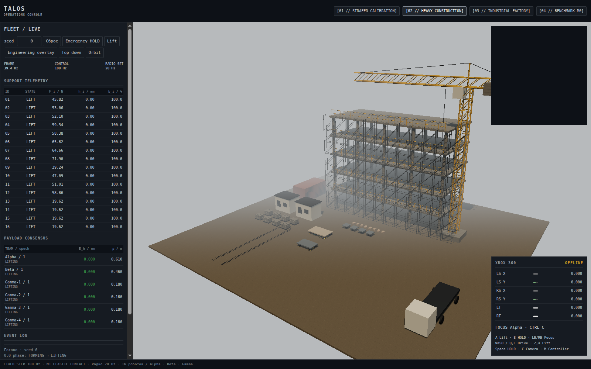
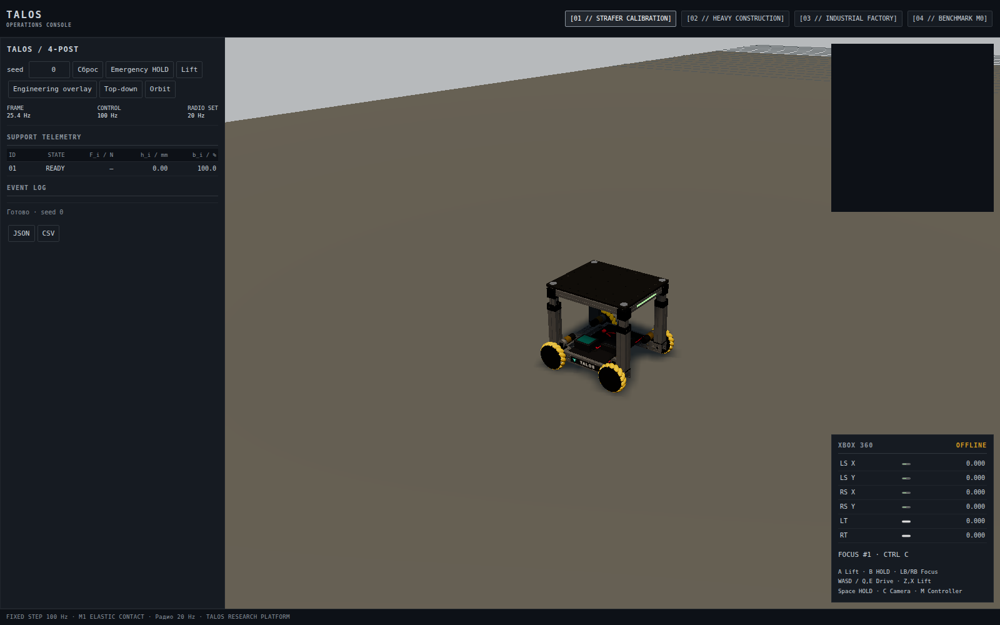
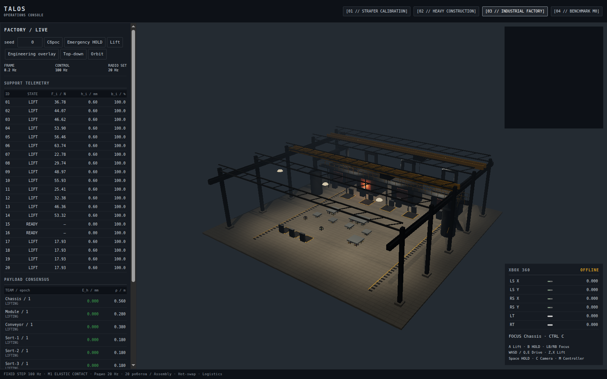
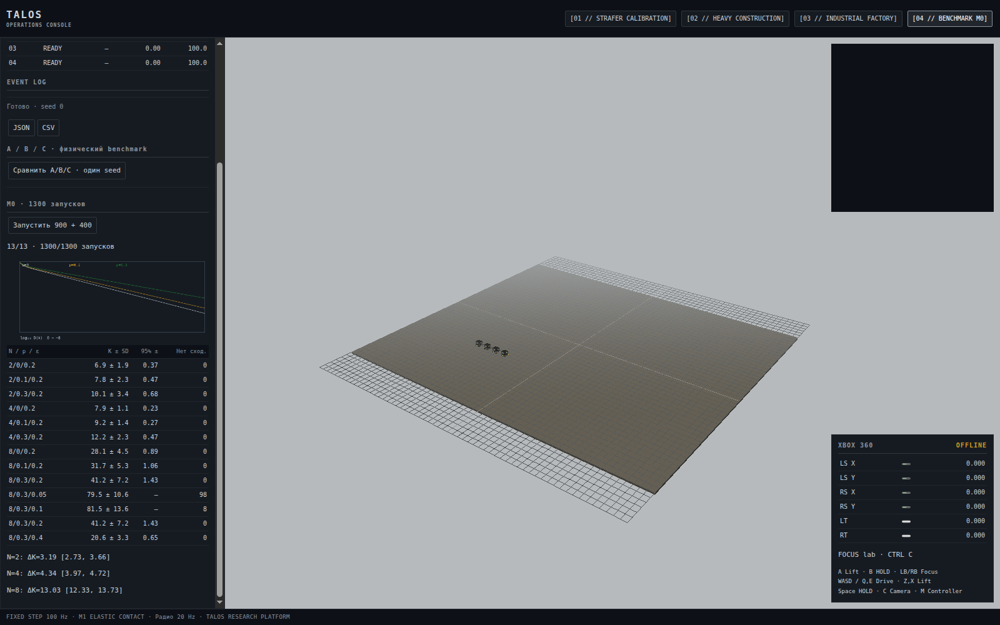
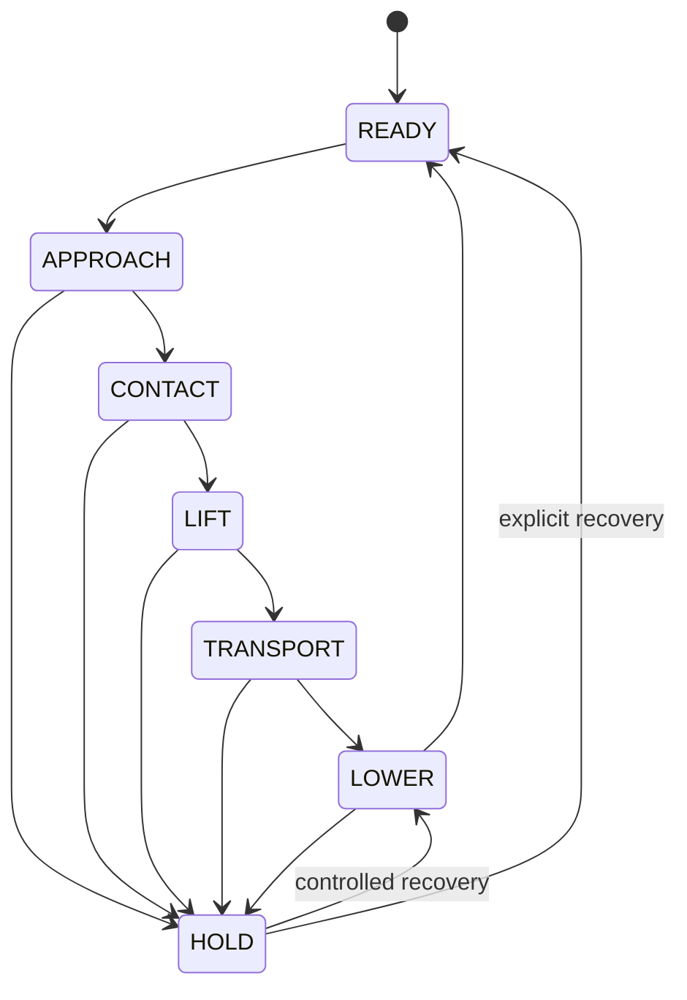
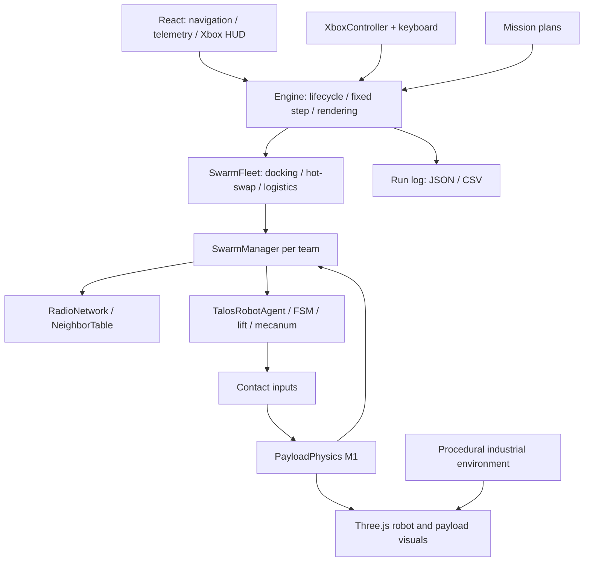

<div align="center">

# TALOS

**Target-Agent Learning & Operational System**

### Совместный подъём. Децентрализованное управление. Измеримый результат.

Браузерная 3D-платформа для исследования роботизированных бригад: от кинематики отдельного Mecanum-шасси до синхронного переноса груза, стыковки агрегатов и замены участников роя.

**React 18 · TypeScript · Three.js r170 · Vite · Vitest**

[Быстрый старт](#быстрый-старт) · [Миссии](#миссии) · [Управление](#управление) · [Математика](#математическая-модель) · [Архитектура](#архитектура) · [Проверки](#проверки)

</div>



*TALOS / Heavy Construction. Реальный кадр приложения: 16 роботов, распределённые команды, реакции опор и запас устойчивости.*

## Идея проекта

Один робот поднимает свою опору. Бригада должна удержать общий груз: согласовать высоты, сохранить контакт, учесть смещённый центр масс и продолжить движение при ограниченной связи. TALOS связывает эти задачи в одной исполняемой модели.

Здесь можно сравнить независимый, централизованный и децентрализованный подъём; наблюдать распределение усилий; проверить реакцию на потерю радио; воспроизвести эксперимент с заданным seed и выгрузить журнал в JSON или CSV.

Текущая реализация — исследовательский симулятор с лабораторными параметрами роботов. Промышленные сцены задают контекст задач; фактические массы грузов в готовых миссиях составляют **2–48 кг**. Параметры оборудования, состояния и ограничения описаны в коде, а визуализация показывает результат работы модели.

## Быстрый старт

Нужны Node.js с npm и браузер с WebGL2. Для разработки удобно использовать Node.js 22; эта версия использовалась при подготовке документации. Геймпад необязателен.

```bash
git clone https://github.com/batryzhan/talos.git
cd talos
npm ci
npm run dev
```

Откройте адрес, напечатанный Vite — обычно **http://localhost:5173**. При занятом порте сервер выберет следующий. Дождитесь сообщения `Готово · seed 0` в журнале: приложение загружает CAD-модель `public/robot.glb` размером около 30 МБ.

| Экран | Прямая ссылка при стандартном порте |
| --- | --- |
| `[01 // STRAFER CALIBRATION]` | http://localhost:5173/?mode=0 |
| `[02 // HEAVY CONSTRUCTION]` | http://localhost:5173/?mode=1 |
| `[03 // INDUSTRIAL FACTORY]` | http://localhost:5173/?mode=2 |
| `[04 // BENCHMARK M0]` | http://localhost:5173/?mode=3 |

Для первого знакомства откройте стройку, включите **Engineering overlay**, затем переключитесь на **Top-down**. Для воспроизводимого перезапуска задайте `seed` и нажмите **Сброс**. Миссии стройки и завода запускают последовательность подъёма автоматически после инициализации.

Сборка для размещения на статическом хостинге:

```bash
npm run build
npx vite preview --host 127.0.0.1
```

Готовый сайт находится в `dist/`. Для загрузки модулей и GLB используйте HTTP-сервер; открытие `index.html` через `file://` не является поддерживаемым способом запуска.

## Миссии

### 01 / Strafer Calibration

Один TALOS на калибровочном полигоне. Режим позволяет проверить движение вперёд, боковой стрейф, вращение, ход четырёхколонного подъёмника и ввод с клавиатуры или Xbox.



Основа — CAD-шасси goBILDA Strafer с процедурными колёсами, подъёмными колоннами, грузовой платформой и электроникой. Геометрические размеры вынесены в [straferSpec.ts](src/robot/straferSpec.ts); параметры подъёмного привода — в [liftDrive.ts](src/robot/liftDrive.ts).

| Узел | Параметр модели |
| --- | --- |
| Рама | 432 × 360 мм |
| Клиренс рамы | 46 мм |
| Mecanum-колёса | Диаметр 140 мм, по 16 роликов под 45° |
| Центры колёс | x = ±168 мм, y = ±208 мм |
| Привод шасси | Параметры 5203 Yellow Jacket, 26,9:1, 223 об/мин без нагрузки |
| Портальный подъёмник | Четыре угловые колонны, двухсекционные направляющие, тросовые приводы |
| Грузовая платформа | 432 × 360 мм, четыре угловых датчика/контактных узла |
| Ход лифта | 0–160 мм; типовое задание миссий — 100 мм |
| Привод лифта | Четыре двигателя, редукция 19,2:1, радиус барабана 16 мм |
| Ограничение реакции опоры | 400 Н на робота по умолчанию; не сертифицированная грузоподъёмность |

В CAD-ассете исходные колёса имеют диаметр 96 мм. При сборке TALOS они заменяются на 140-миллиметровые; рама поднимается на разность радиусов **22 мм**. Порядок колёс во всех вычислениях: `FL → FR → RL → RR`.

### 02 / Heavy Construction

Многоэтажный железобетонный каркас с круглыми колоннами, плитами перекрытий и лесами; решётчатый башенный кран со стрелой, противовесом и подвесом; бытовки, контейнер, паллеты блоков, следы колёс и зона разгрузки.

| Команда | Роботы | Груз | Задача |
| --- | ---: | ---: | --- |
| Alpha | 8 | 48 кг | Совместный перенос плиты со смещённым центром масс |
| Beta | 4 | 20 кг | Отдельный транспортный манёвр |
| Gamma-1…4 | 4 × 1 | По 2 кг | Демонстрационная расчистка коридора |

У Alpha и Beta локальное смещение центра масс составляет `r_c = (0,12; 0,04) м`, поэтому реакции опор не обязаны быть одинаковыми даже при согласованном подъёме.

Маршрут Alpha проходит через точки `(1; −1,5) → (8,5; −1,5) → (9; 8)` в метрах. Он заканчивается в монтажной зоне рядом с краном. Передача груза на крюк и механика монтажа краном пока не моделируются.

План бригады и маршрут: [HeavyConstructionSim.ts](src/missions/HeavyConstructionSim.ts).

### 03 / Industrial Factory



Два мостовых крана на подкрановых путях, стальные пролёты, технологические печи, вертикальные резервуары, вентиляционные трубопроводы и эстакада с перилами и лестницей. Верхние светильники, тёплый свет технологической зоны и `Fog` формируют освещение цеха.

В сценарии участвуют **20 роботов**:

| Команда / роль | Роботы | Груз | Назначение |
| --- | ---: | ---: | --- |
| Chassis | 6 | 30 кг | Базовый агрегат для стыковки |
| Module | 4 | 16 кг | Подвижный модуль для стыковки |
| Conveyor | 4 | 16 кг | Бригада для демонстрации hot-swap |
| Резерв | 2 | — | Замена разрядившихся участников |
| Sort-1…4 | 4 × 1 | По 2 кг | Доставка к четырём терминалам |

**Стыковка.** `DOCKING_ALIGN → PRECISION_MATE → MATED`. Две команды согласуют задания высоты через консенсус M0; подвижная команда сближает модуль с целевой позой. Условие завершения включает ошибку высоты менее 1 мм, положения менее 1 мм и угла менее 0,2° с удержанием допусков не менее 0,3 с. Это критерии алгоритма; достижение проверяется по измеряемой в модели позе.

**Горячая замена.** При `b_i < 25%` система ищет заряженный резерв и свободную зарядную станцию. Перед выводом участника проверяется полигон оставшихся опор. Бригада останавливается и удерживает груз; разрядившийся робот опускает платформу и уезжает, резерв занимает его точку. Удаление и добавление участника изменяют `epoch` — обычно два инкремента за полный цикл замены.

В демонстрации заряд робота №11 принудительно снижается до **24,9% после 12 с модельного времени**. Этот сценарный триггер нужен для воспроизводимого запуска hot-swap. Условия безопасности могут остановить замену или переводить бригаду в `HOLD`; завершение не гарантируется одним лишь наличием резерва.

**Логистика.** Четыре сортировочных робота получают временные слоты на общий участок движения и направляются к терминалам. Это расписание пересечения, без полноценного планировщика обхода препятствий.

План цеха: [SmartFactorySim.ts](src/missions/SmartFactorySim.ts). Стыковка, резервы, зарядка и смена состава: [SwarmFleet.ts](src/swarm/SwarmFleet.ts).

### 04 / Benchmark M0



Научный режим разделяет два эксперимента:

| Эксперимент | Что сравнивает |
| --- | --- |
| Физический A/B/C | Четыре робота, груз 24 кг, одинаковый seed; 15 с моделирования, после 8 с — потеря пакетов 30% и отключение радио агента №1 |
| Консенсус M0 | 1300 скалярных прогонов с разными размерами кольца, потерями связи и шагом ε |

Серия M0 состоит из **900 + 400 прогонов**:

- `N ∈ {2, 4, 8}`, `p ∈ {0; 0,1; 0,3}`, `ε = 0,2`: девять конфигураций по 100 seed.
- `N = 8`, `p = 0,3`, `ε ∈ {0,05; 0,1; 0,2; 0,4}`: ещё четыре конфигурации по 100 seed.

Горизонт — 100 шагов, порог сходимости — `D(k) ≤ 0,01`. Таблица показывает среднее число шагов `K`, стандартное отклонение, доверительный полуинтервал и число несошедшихся прогонов. Среднее и SD считаются по сошедшимся наблюдениям; t-полуинтервал выводится только при сходимости всех 100 прогонов. Парное сравнение `p = 0` и `p = 0,3` использует общие seed и 2000 bootstrap-выборок доступных пар.

График показывает `log₁₀` среднего разброса `D(k)` для серии с `N = 8`. Это скалярный эксперимент, его шаги не равны секундам физической симуляции. Код: [consensus.ts](src/swarm/consensus.ts), [science.ts](src/ui/science.ts), [physicalBenchmark.ts](src/ui/physicalBenchmark.ts).

## Управление

### Клавиатура и мышь

Используются физические коды клавиш: раскладка языка не меняет назначение.

| Ввод | Действие |
| --- | --- |
| `W` / `S` | Положительная / отрицательная скорость по x |
| `A` / `D` | Положительная / отрицательная скорость по y |
| `Q` / `E` | Вращение против / по часовой стрелке |
| `Z` / `X` | Поднять / опустить; у бригады меняется задание высоты |
| `Enter` | Запросить подъём |
| `Space` | Аварийный HOLD |
| `M` | Цикл контроллеров A → B → C |
| `C` | Камера: orbit → centroid → topdown |
| `Tab` | Выбрать следующую бригаду |
| Перетаскивание мышью | Орбитальная камера; правая кнопка — панорамирование |
| Колесо мыши | Приблизить / отдалить орбитальную камеру |

В калибровке скорости задаются в системе координат робота; ручное движение строительной бригады задаётся в мировой плоскости. Клавиатурные обработчики не срабатывают при фокусе на `input`, `button` или `select`: щёлкните по 3D-сцене перед управлением.

Кнопки панели: **Сброс**, **Emergency HOLD**, **Lift**, **Engineering overlay**, **Top-down**, **Orbit**, **JSON**, **CSV**. HOLD блокирует движение и удерживает высоту; сброс экрана создаёт новый экземпляр симуляции.

### Xbox 360 / standard Gamepad API

Подключите контроллер и нажмите любую кнопку, чтобы браузер обнаружил устройство. Индикатор `ONLINE` подтверждает подключение. Для доступа к Gamepad API используйте localhost либо HTTPS; вибрация зависит от браузера и контроллера.

| Элемент | Действие |
| --- | --- |
| LS | Ход и стрейф; в режиме бригады направление связано с азимутом камеры |
| RS X | Вращение |
| RT / LT | Аналоговая команда подъёма / опускания |
| A | Запрос подъёма |
| B | Emergency HOLD с запросом виброотдачи |
| X | Контроллер A / B / C |
| Y | Переключение камеры |
| LB / RB | Предыдущий / следующий доступный объект управления |
| D-pad вверх / вниз | Ограничение команды: 25 / 50 / 75 / 100% |
| START | Пауза / продолжение шага симуляции |

Радиальная мёртвая зона стиков — **0,12**. За ней используется плавная линейно-кубическая характеристика с долей кубической части `0,6`. Триггеры также фильтруются.

Драйвер декодирует дополнительные действия: RS Y — наклон камеры, BACK — reset, D-pad влево/вправо — сценарий. Текущий `Engine` не подключает эти действия к полноценному наклону, сбросу и переключению экранов. Для выбора сцены и сброса используйте интерфейс. Ручная планарная команда бригаде подключена в строительной миссии; заводская миссия ведётся автоматикой стыковки и логистики.

## Телеметрия и операторский интерфейс

Плоские панели `#0d1117` / `#161b22`, разделители `#21262d`, моноширинные данные с `tabular-nums`. Цвет отражает состояние: зелёный — норма, янтарный — отклонение, красный — HOLD/ошибка. Числа выровнены по правому краю.

| Показатель | Смысл | Единицы |
| --- | --- | --- |
| `F_i` | Расчётная реакция контакта робота с грузом | Н |
| `h_i` | Выдвижение лифта относительно его нулевого положения | мм |
| `b_i` | Заряд аккумулятора | % |
| `E_h` | Накопленная RMS-ошибка высот относительно среднего бригады | мм |
| `E_traj` | Накопленная RMS-ошибка положения относительно опорного задания; API и журнал | м |
| `ρ` | Знаковый запас до границы полигона опор | м |
| `epoch` | Версия состава бригады | Целое число |
| `FRAME` | Сглаженная частота отрисовки | Гц |
| `RADIO SET` | Настроенная частота передачи; не измеренный поток принятых пакетов | Гц |

`E_h` накапливается по отсчётам `LIFT` и `TRANSPORT`; это не мгновенная разница максимальной и минимальной высоты. Текущий размах `heightSpread` доступен отдельно в телеметрии ядра. Символ `—` означает отсутствие значения.

**Частоты различаются:** Engine интегрирует мир шагом 10 мс (**100 Гц**), локальное управление работает на **50 Гц**, радио — на **20 Гц**, React-панель обновляется раз в 250 мс. Текущая надпись `CONTROL 100 Hz` в панели относится к шагу Engine; частота локального контроллера задана константой `CONTROL_HZ = 50` в контракте.

Engineering overlay показывает полигон опор, направление к ближайшей границе, сетевые связи и векторы реакций. Его можно отключить, чтобы оценить сцену без диагностических линий.

## Математическая модель

### M0 / Скалярный консенсус

Каждый агент обновляет скаляр по состояниям соседей:

$$
x_i(k+1)=x_i(k)+\varepsilon\sum_{j\in\mathcal N_i(k)}(x_j(k)-x_i(k)).
$$

Матричная форма: $x(k+1)=(I-\varepsilon L(k))x(k)$. Все приращения вычисляются из старого вектора, затем применяется общий синхронный шаг. Симметричные обмены сохраняют сумму состояний. Реализация проверяет ограничение $0<\varepsilon<1/d_{max}$; разброс $D(k)=\max_i x_i(k)-\min_i x_i(k)$ служит критерием сходимости.

Seed задаёт начальные значения и последовательность выпадения рёбер. Доступные топологии и их построение находятся в [graph.ts](src/swarm/graph.ts).

### M1 / Упругий контакт и груз

Для вертикального контакта используются деформация и относительная скорость:

$$
\delta_i=z_{pad,i}-z_{payload}(x_i,y_i),\qquad
F_i=\begin{cases}\max(0,k_i\delta_i+c_i\dot\delta_i),&\delta_i>0,\\0,&\delta_i\leq0.\end{cases}
$$

Опора может толкать груз, но не притягивает его. Начальное упругое равновесие находится методом активного набора с исключением опор без сжатия. Далее интегрируются вертикальное движение и малые углы крена/тангажа под действием сил и моментов; жёсткие контакты разрешаются подшагами не более **0,25 мс**. В готовых миссиях используются `k_i = 20 000 Н/м`, `c_i = 200 Н·с/м`, `g = 9,81 м/с²`.

Горизонтальная поза груза оценивается по позам роботов, а не выводится из полноценной пространственной динамики трения. Модель контакта: [M1.ts](src/physics/M1.ts).

### Подъём и виртуальная платформа

Привод учитывает редуктор, КПД, барабан, число двигателей и линейную характеристику момент–скорость:

$$
F_{drive}\approx\frac{n_m\eta G\tau_m}{r_s},\qquad P_{mech}=Fv.
$$

Скорость подъёма уменьшается с нагрузкой. Управление высотой использует локальную ошибку и связь с соседями:

$$
u_i=\operatorname{sat}\left[k_p(h^*-h_i)+k_c\sum_{j\in\mathcal N_i}w_{ij}(h_j-h_i)\right].
$$

| Контроллер | Источники данных | Особенность |
| --- | --- | --- |
| A / Independent | Собственная высота и нагрузка | Без соседского согласования, `k_c = 0` |
| B / Centralized | Истинные состояния всех участников | Идеализированный координатор и полный обмен |
| C / Decentralized | Доступные сообщения соседей | Задержки, потери и фильтрация радио |

Для совместного движения опорные скорости выводятся из команды виртуальной платформы:

$$
\mathbf v_i=\mathbf v_c+\omega_c\begin{bmatrix}-r_{iy}\\r_{ix}\end{bmatrix}.
$$

Затем добавляется коррекция ошибки позиции и курса, выполняется переход в систему робота и обратная Mecanum-кинематика. Реализация: [controllers.ts](src/swarm/controllers.ts), [virtualPlatform.ts](src/swarm/virtualPlatform.ts), [mecanum.ts](src/robot/mecanum.ts).

### Устойчивость, связь и HOLD

Полигон опор строится по выпуклой оболочке контактных точек. `ρ > 0` означает, что проекция центра масс внутри полигона; отрицательное значение — снаружи. При замене участника проверяется полигон без выводимой опоры. Типовой минимальный запас — **0,03 м**; для демонстраций одиночных перевозчиков предусмотрена отдельная обработка площади площадки и ослабленный порог допуска в Engine.

Радиопакеты содержат `id`, `task`, `epoch`, `seq`, время и состояние агента. Приёмник отбрасывает старые эпохи, повторные номера, просроченные сообщения, высоты вне диапазона и пакеты другой задачи. Базовая сеть — кольцо с задержкой **50 мс**, максимальным возрастом сообщения **0,5 с** и нулевыми потерями; параметры можно менять через API.



Это основной рабочий цикл; полная таблица переходов и проверки готовности находятся в [fsm.ts](src/swarm/fsm.ts). Причины HOLD включают перегрузку, недопустимое рассогласование, потерю требуемой связи и нарушение условий безопасности. HOLD означает активную фиксацию подъёмника с торможением, а не простое отключение питания.

## Архитектура



| Каталог / файл | Ответственность |
| --- | --- |
| `src/App.tsx`, `src/main.tsx` | React-приложение, смена экранов и запуск экспериментов |
| `src/components/` | Навигация, таблицы телеметрии, HUD контроллера |
| `src/platform/Engine.ts` | Жизненный цикл Three.js, цикл симуляции, управление и визуальные связи |
| `src/platform/IndustrialEnvironment.ts` | Процедурные здания, краны, оборудование, материалы и свет |
| `src/missions/` | Планы бригад, грузы, маршруты и параметры сценариев |
| `src/contracts/types.ts` | Общие типы, единицы, сообщения, состояния и частоты |
| `src/robot/` | Спецификация шасси, геометрия, кинематика, подъёмный привод, состояние робота |
| `src/swarm/` | Графы, радио, консенсус, контроллеры, FSM, менеджеры бригад и флота |
| `src/physics/` | Равновесие, контакт, интеграция груза и устойчивость |
| `src/ui/` | Физический benchmark, статистика M0, график и экспорт журналов |
| `tests/` | Тесты робота, геометрии, геймпада, сети, консенсуса и флота |
| `public/robot.glb` | Базовый CAD-ассет шасси |
| `tools/` | STEP → промежуточный кэш → GLB |

**Единицы и координаты.** Внутри модели — метры, секунды, радианы и ньютоны. Мир имеет ось Z вверх, пол — `z = 0`; у робота +X направлен вперёд, +Y влево, положительное вращение — против часовой стрелки при взгляде сверху. Идентификаторы роботов начинаются с 1. Миллиметры используются для отображения высот в UI.

**Окружение.** Архитектурный план задаётся в метрах. Статическая геометрия компилируется по материалам, сокращая число draw calls. Бетон и грунт используют детерминированные процедурные текстуры; материалы различаются шероховатостью и металличностью. Используются PCF soft shadows, карта направленного света 2048², ACES tone mapping и OutputPass; bloom отсутствует. `root.userData.diagnostics` хранит число материальных групп и треугольников окружения.

**Сборка.** `vite.config.ts` выделяет `react`, `simulation`, `three`, `three-addons`, `three-shaders`. Разделение исходников Three.js позволяет держать каждый JS-чанк ниже стандартного порога предупреждения Vite без увеличения лимита.

## Журналы и воспроизводимость

Кнопки **JSON** и **CSV** выгружают журнал текущего Engine. Во время бригадных миссий записи формируются примерно каждые 0,1 с модельного времени для участников команд.

Поля экспорта:

```text
run_id, seed, controller, N, p, epoch, time,
agent_id, state, command, E_h, E_traj, TSR, SSR
```

`command` — фактическая вертикальная скорость лифта в текущей записи. `E_h` и `E_traj` экспортируются в метрах. `TSR` и `SSR` предусмотрены контрактом, но текущий Engine их не заполняет. В журнале Engine поле `p` записывается как `0`; это не автоматическое измерение потерь. Результаты 1300 прогонов M0 отображаются отдельно в таблице и графике, а не попадают в этот журнал.

Для сравнения экспериментов фиксируйте seed, контроллер, параметры сети, состав, массы и геометрию опор. Одинаковый seed воспроизводит случайные потоки при одинаковой последовательности вызовов модели; ручной ввод и частота кадров могут менять течение интерактивного эксперимента.

## CAD-пайплайн

GLB уже включён в репозиторий — STEP-файл для обычного запуска не требуется. Для пересборки из исходного STEP доступны два этапа:

```bash
node tools/parse.mjs "3209-0001-0004 assembly.STEP" /tmp/talos-cad-cache.bin
RATIO=0.2 node tools/build.mjs /tmp/talos-cad-cache.bin public/robot.glb
```

`parse.mjs` читает STEP через OpenCascade WASM и сохраняет промежуточные меши. `build.mjs` разделяет сборку на шасси и колёса, упрощает геометрию через meshoptimizer и записывает GLB. `RATIO` задаёт целевую долю сохраняемых треугольников; мелкие детали ограничены минимальным числом треугольников. Разбор больших STEP может занимать несколько минут. Файлы `*.STEP` исключены из Git.

Команда `npm run convert` пока ссылается на отсутствующий `tools/convert.mjs`; используйте приведённые выше команды напрямую. Изменение GLB должно сохранять ожидаемые имена узлов и структуру для [загрузчика робота](src/robot/TalosRobotAgent.ts).

## Проверки

```bash
npm test
npm run typecheck
npm run build
```

На момент подготовки README прошли **124 теста в 10 файлах**, TypeScript-проверка и production-сборка. Число тестов относится к текущему состоянию исходников; актуальный результат всегда выдаёт `npm test`.

Покрываемые сценарии включают:

- Сохранение среднего и сходимость M0, ограничения шага и случайные потери рёбер.
- Прямую и обратную кинематику, привод лифта, нагрузку, фиксацию и параметры CAD-геометрии.
- Декодирование геймпада, мёртвые зоны, переключение фокуса и виброотдачу.
- Групповую готовность, переходы FSM, согласование подъёма и реакции на отказы.
- Одновременную работу нескольких бригад, стыковку и замену участников.
- Упругое равновесие, реакции контактов и связку SwarmManager с физикой груза.
- Корректность скомпилированной геометрии обеих индустриальных локаций.

Скриншоты в [docs/screenshots](docs/screenshots) сняты с работающего приложения через Chrome DevTools, `seed = 0`, окно 1600 × 1000. Это реальные кадры интерфейса и Three.js-сцен. Показания FPS на них относятся к среде захвата и не являются оценкой производительности на пользовательском GPU.

## Границы текущей реализации

- Геометрия и физические параметры ориентированы на небольшие лабораторные платформы. Многотонный промышленный транспорт требует другой модели оборудования и валидации нагрузок.
- M1 описывает упругие вертикальные контакты и малые углы груза. Полная динамика твёрдых тел, трение, разрушение, столкновения с окружением и предотвращение межроботных коллизий не реализованы.
- Краны и технологическое оборудование являются окружением. Захват крюком, работа печей и технологические операции не рассчитываются.
- Четыре визуальных угловых датчика робота агрегируются в один опорный контакт для расчёта груза; это не независимая четырёхточечная FEM-модель каждого робота.
- Завершение стыковки или hot-swap зависит от условий и защит. Субмиллиметровый допуск — условие алгоритма в симуляции, без заявления о точности реального оборудования.
- Полноценное мобильное управление не предусмотрено; для работы удобнее настольный браузер, мышь и клавиатура либо геймпад.

## Развитие проекта

Практические следующие направления: согласование обозначений частот в UI с контрактом, подключение оставшихся действий геймпада, предотвращение коллизий, интерактивная настройка сетевых отказов, ограничение размера журналов, отдельный экспорт результатов M0 и завершённый сценарий передачи плиты крану.

Спецификации направлений работы находятся в [AGENTS.md](AGENTS.md) и [CLAUDE.md](CLAUDE.md). README описывает текущее поведение исходников; эти файлы также содержат целевые требования спринта и не заменяют проверку реализации.

Отдельный файл лицензии в репозитории отсутствует. Условия распространения кода и сторонних CAD-ассетов следует определить отдельно.
